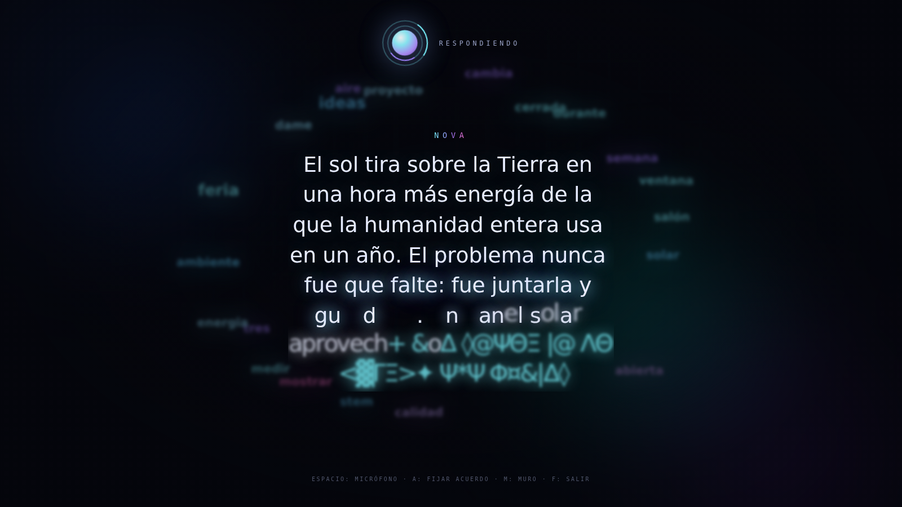
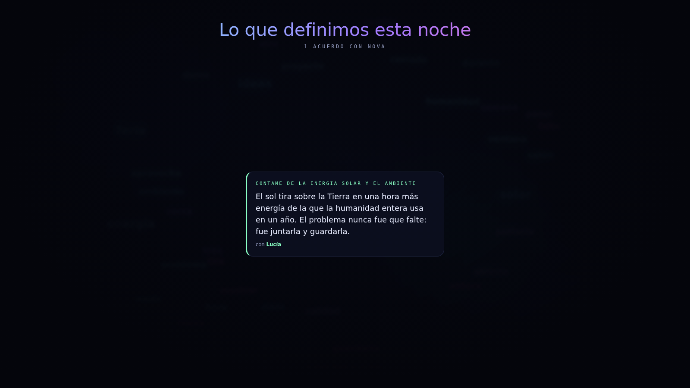

# NOVA · IASTEM

Sistema para una performance en vivo: los estudiantes conversan con NOVA, una
inteligencia artificial de escenario, frente al público y en pantalla gigante.
Las letras **se materializan en el aire**, la voz de quien habla mueve los
visuales, y lo que el grupo va definiendo queda en un muro que se muestra al
final.

NOVA **no improvisa**: todo lo que dice sale de un guion en texto plano que se
le carga antes de la función. Cuando escucha el pie, contesta con su
parlamento; y desde un **panel de control**, en otra ventana o en el celular,
se ve por dónde va y se la maneja a mano. Como opción, un **asistente de
ubicación** con IA ayuda a reconocer el pie cuando lo dicen con otras palabras,
sin escribir nunca lo que NOVA responde.





---

## Probala ya

```bash
npm start            # → http://localhost:3000
```

No hace falta configurar nada. Sin Node, la página publicada en GitHub Pages
hace lo mismo; la única diferencia es desde dónde se puede abrir el panel de
control (ver más abajo).

## Qué hace

| | |
|---|---|
| **Guion** | Se carga un guion en texto plano y NOVA dice sus parlamentos cuando escucha el pie. Nada más, nada menos. |
| **Panel de control** | En otra ventana o en el celular: muestra por dónde va NOVA, qué oyó y qué dijo, y permite manejarla. |
| **Asistente de ubicación** | Opcional. Una IA decide a qué pie corresponde lo que se oyó cuando el parecido de palabras no alcanza. Nunca escribe lo que dice NOVA. |
| **Letras estilo Jumanji** | Cada carácter entra como un glifo extraño que muta hasta encontrar su forma. |
| **Nube de palabras** | Las palabras importantes flotan de fondo, crecen si se repiten y se disuelven solas. |
| **Voz en vivo** | Micrófono continuo: el estudiante habla, NOVA reconoce el pie y contesta en voz alta. |
| **La voz que se ve** | El volumen real de quien habla mueve el orbe y la nube: se nota que NOVA lo está escuchando a él. |
| **Turnos** | Cada estudiante tiene nombre y color; la pantalla dice quién habla. |
| **Muro de acuerdos** | Lo que definen junto a NOVA queda fijado y se muestra todo junto al cierre. |
| **Dos vistas** | *Consola* para operar y *Escenario* a pantalla completa para proyectar. |

## El guion

En el botón **Guion** se pega un guion en texto plano, como el de una obra, o
se abre un archivo `.txt`:

```
# Las líneas con numeral son comentarios.
NOVA?: No te escuché bien. ¿Me lo repetís?

ANA: Hola NOVA, ¿nos escuchás?
NOVA: Los escucho. Soy NOVA, la inteligencia de esta muestra.

TOMÁS: ¿Y cómo aprendiste a hablar?
NOVA: Parecido a como aprendiste vos a reconocer perros...

[Un cierre sin pie: se dice a mano]
NOVA: Gracias por esta noche.
```

Las reglas son pocas:

- `NOMBRE: texto`, una línea por parlamento. Las líneas de **NOVA** (también
  vale `IA:`) son lo que ella dice; la línea anterior es su **pie**.
- Cuando alguien dice algo parecido al pie, por voz o por teclado, NOVA
  contesta con el parlamento tal cual, letra por letra y en voz alta.
- `NOVA?: texto` es un **comodín**: lo que dice cuando lo que oye no se parece
  a ningún pie. Puede haber varios; elige uno al azar. Sin comodines, se queda
  callada y el panel avisa qué oyó.
- La comparación es tolerante: ignora mayúsculas, acentos y signos, acepta
  palabras cambiadas y frases dichas con más o menos vueltas. En el panel se
  elige cuánto: *estricta*, *normal* o *amplia*. Pies de cuatro o cinco
  palabras funcionan mejor que un "sí" suelto.
- El guion tiene orden y **el parlamento que sigue corre con ventaja**: si
  dos pies se parecen, gana el que toca. La consola y el panel muestran en todo
  momento qué pie se está esperando.
- Con la tecla **S**, o desde el panel, NOVA dice el parlamento que sigue sin
  esperar el pie. Un parlamento sin pie antes (una apertura, un cierre) solo
  se dice así, o tocándolo en la lista.
- Las líneas que empiezan con `#`, y las acotaciones entre `[corchetes]` o
  `(paréntesis)`, se ignoran. Una línea sin nombre continúa la anterior.
- El guion también sugiere qué se ve en pantalla, con líneas justo antes
  del parlamento de NOVA en el que pasan:
  - `IMAGEN: dirección | pie de foto`: la imagen **toma la pantalla, en
    grande, y se queda**, sin ningún texto encima: NOVA se oye pero no se lee.
    Sigue hasta que otra la reemplace o la saques con la tecla **I** o desde
    el panel. Con un tiempo al final, `| 10s`, se va sola al cumplirse.
  - `FONDO: dirección | pie`: una imagen de fondo que **se queda**, detrás
    del texto, hasta que otra la reemplace o `FONDO: ninguno` la saque.
  - `PALABRA: CREATIVIDAD`: la palabra queda **flotando junto a NOVA**, sola
    en pantalla, hasta el próximo parlamento o `PALABRA: ninguna`.
  - `CÁMARA: encender` o `CÁMARA: apagar`: la cámara del público.

  Las imágenes van en `public/imagenes/` (ver el `LEEME.txt` de ahí) o se
  enlazan con su dirección completa. En el panel, cada línea con indicaciones
  de pantalla tiene un botón **Solo pantalla** que las aplica sin que NOVA
  hable: sirve para los tramos en que hablan solo los estudiantes.

En `docs/` hay guiones listos para cargar: `guion-prueba.txt`, corto, y
`guion-creatividad.txt`, una escena completa con fondo, imagen, palabra y
reflexión final.

### El asistente

El parecido de palabras alcanza cuando los estudiantes dicen más o menos lo
escrito. Cuando lo dicen con otras palabras ("¿de dónde sacás lo que sabés?"
en vez de "¿cómo aprendiste?"), o el micrófono transcribe mal, conviene el
asistente: una IA a la que, cada vez que lo oído no coincide con claridad, se
le pregunta **a qué pie corresponde**.

El asistente tiene dos usos, que se eligen en su panel:

- **Solo ubicar el pie.** Contesta un número y nada más. Lo que NOVA dice
  sale del guion, siempre; si no hay pie, comodín o silencio.
- **Ubicar y conversar** (el que viene elegido). Si lo oído no corresponde a
  ningún pie, la IA **improvisa como NOVA**: breve, en el espíritu del guion,
  siguiendo el hilo de la conversación y, si viene al caso, encaminando hacia
  lo que sigue en el guion. Es una sola consulta que decide las dos cosas, y
  la respuesta llega de a pedazos para que las letras arranquen enseguida. En
  el panel se escribe quién es NOVA cuando improvisa: cómo habla y qué sabe de
  la función.

En los dos casos el guion manda: un pie reconocido siempre gana, y la IA solo
habla cuando el guion no tiene nada preparado. Para probar la clave y charlar
con NOVA sin tocar la función está `prueba-api.html`, enlazada desde el panel
Asistente: comprueba la clave, mide cuánto tarda, ubica pies sobre un guion
chico y conversa con memoria. Las respuestas improvisadas se
distinguen en la consola con un borde violeta, y el panel de control las
anota.

Es opcional y funciona con **Claude (Anthropic)** o con **OpenAI**. La
clave puede estar en dos lugares:

| Dónde | Cómo | Para qué |
|---|---|---|
| **En el servidor** | `ANTHROPIC_API_KEY` u `OPENAI_API_KEY` en el `.env` (ver `.env.example`) y `npm start`. Si están las dos, gana Claude. | Lo más seguro: el navegador nunca la ve. |
| **En el navegador** | Botón **Asistente**, arriba a la derecha: elegir con quién, pegar la clave, *Probar* y guardar. | Para el sitio publicado en Pages, que no tiene servidor. Queda en ese navegador y viaja solo a esa API. |

Con Claude usa `claude-opus-5-5` con esfuerzo bajo, que contesta en un segundo
o dos; `claude-haiku-5-5` es más rápido y más barato si se nota la espera. El
modelo se cambia en el mismo lugar que la clave. Cada consulta cuesta una
fracción de centavo y solo se hace cuando el parecido no alcanza.

Sin clave no pasa nada: NOVA ubica los pies por parecido, como siempre. Con
clave, el panel de control muestra "con asistente" junto al progreso, y en el
registro se ve cuándo fue el asistente el que ubicó el pie. Nunca escribas la
clave en el código del repositorio: si es público, queda expuesta apenas la
subas.

## El panel de control

El panel es otra página, `control.html`, que se habla con el escenario. Muestra
en qué está NOVA (escuchando, hablando, en espera), qué fue lo último que oyó y
dijo, el guion con la línea que sigue resaltada, y un registro de lo que fue
pasando. Desde ahí se puede:

- decir el parlamento que sigue, o saltar a cualquiera tocándolo;
- cargar otro guion, volver al principio, apagar el seguimiento;
- cambiar la pantalla: portada, charla, muro, modo escenario;
- prender y apagar el micrófono y la voz; cortar un parlamento;
- poner la cámara del público en pantalla, y esconder o mostrar la imagen
  de este momento;
- pasar el turno al siguiente estudiante y fijar acuerdos en el muro;
- escribir algo para que NOVA lo diga ya, o escribir lo que dijo una persona
  si el micrófono no lo captó.

Hay dos maneras de abrirlo, y el botón **Panel** del escenario las explica:

| Dónde | Cómo | Qué hace falta |
|---|---|---|
| **En la misma computadora** | *Panel → Abrir en otra ventana.* El escenario va al proyector y el panel queda en la pantalla de la notebook. | Nada: anda hasta en GitHub Pages. |
| **Desde el celular, por internet** | *Panel → Crear la sala para el celular.* NOVA muestra un código y un QR. En el celular se escanea el QR (o se abre `control.html` y se escribe el código) y listo: lo que se toca en el celular pasa en la computadora y en la tele. | Internet en los dos. El celular puede estar en cualquier red, hasta con sus datos. Anda desde GitHub Pages. |
| **Desde el celular, en la misma red** | Correr `npm start` en la computadora que proyecta y abrir en el celular la dirección que muestra la consola, algo como `http://192.168.1.20:3000/control.html`. | Node, y que los dos estén en la misma red Wi-Fi. No necesita internet. |

La sala usa dos caminos a la vez, y el panel dice cuál anda: **directo**
(WebRTC; el escenario y el celular se encuentran por un servidor público de
PeerJS y después se hablan sin pasar por nadie) y **por relevo** (un servidor
público de MQTT, para las redes que no dejan hablar directo, como el Wi-Fi
de un instituto o los datos del celular). Con que uno de los dos ande, la
sala funciona; cada mensaje va por los dos y se descarta el repetido. Lo que
pasa por el relevo es público para quien tenga el código de la sala (seis
letras al azar): por eso NOVA no manda claves por ahí, solo el guion y las
órdenes del panel.

El código de la sala queda guardado en los dos: si se recarga la página de
NOVA o la del celular, se vuelven a enganchar solos. *Otro código* cambia la
sala y *Cerrar la sala* la apaga. Mientras el panel está conectado, el celular
no apaga la pantalla. Si querés usar un servidor MQTT propio, ponelo en la
consola del navegador, en la computadora y en el celular:
`localStorage.setItem('nova:relevo', 'wss://tu-servidor/mqtt')`.

Si el celular no entra, abrí en él `prueba-sala.html` (hay un enlace en el
diálogo Panel, junto al QR): prueba qué deja pasar esa red (la señal, la
dirección pública, cada relevo) y, con el código, si llega al escenario. El
botón *Copiar el resultado* arma un informe para pegar y pedir ayuda.

El servidor propio no guarda nada ni entiende los mensajes: solo releva lo que
una página dice a las demás. Si el panel pierde la señal, lo dice abajo en rojo
y se vuelve a enganchar solo cuando el escenario reaparece.

## Cómo se usa

| Acción | Cómo |
|---|---|
| Hablarle | El micrófono **queda encendido solo**. El botón, o la **barra espaciadora**, lo apagan y lo vuelven a prender |
| Escribirle | Campo de texto, **Enter** para enviar |
| Proyectar | Botón *Modo escenario*, o tecla **F** |
| Volver | **Esc** |
| Cortar un parlamento | Botón *Detener*, o **Esc** mientras habla |
| Silenciar a NOVA | Interruptor *Voz de NOVA* (viene encendida) |
| Empezar de cero | Botón *Limpiar* |

El micrófono se prende solo al abrir la página, si el navegador ya dio el
permiso, y si se cae por algo pasajero se vuelve a prender. Apagarlo es una
decisión: se recuerda hasta que lo vuelvas a prender. Mientras escucha, abajo
del botón se ve lo que va oyendo y un diagnóstico chiquito ("escuchando",
"detecta voz", "transcribiendo", "sin respuesta, reintento 2"), que también se
ve en el panel.

NOVA contesta rápido: si lo que la persona va diciendo ya coincide con
claridad con un pie, **contesta antes de que termine la frase**. Si la
coincidencia es a medias, espera a que termine y deja pasar **0,7 segundos de
silencio**, por si el grupo sigue con otra frase.

### La voz de NOVA

NOVA habla con una de dos voces, que se eligen en **Asistente y voz → La voz
de NOVA**, con un botón para escuchar una frase antes de decidir:

| Voz | Cómo suena | Qué hace falta |
|---|---|---|
| **La del navegador** | Depende del navegador. En Edge, las voces "Natural" suenan a persona; en Chrome, las de Google son aceptables; las demás, a robot. NOVA elige sola la mejor que haya, en rioplatense si existe, y se puede elegir otra a mano. | Nada. |
| **Neuronal por API** | Mucho más natural: el sintetizador de OpenAI, con voces como *nova*, *coral* o *sage*, y una instrucción de cómo tiene que sonar (acento uruguayo, cálida, pausada). | Una clave de OpenAI, en el `.env` del servidor o pegada en el panel. Si el asistente ya usa OpenAI, se usa esa. |

Las dos están pensadas para que NOVA hable de corrido:

- Un parlamento del guion (o un texto del panel) se le da a la voz **entero
  y de una vez**, apenas empieza, mientras en la pantalla se va formando. Lo
  que la IA improvisa se le va dando por frases: la primera sale enseguida y
  las demás se juntan en trozos largos, porque cada trozo le cuesta al
  sintetizador un arranque, y ahí es donde se notaban los cortes.
- La voz por API llega **en chorro**: el audio se reproduce a medida que
  llega, pegado al anterior sin un hueco, con Web Audio. Arranca en menos de
  un segundo y no se corta entre un trozo y otro. Si la API falla a mitad de
  la función, NOVA avisa y sigue con la voz del navegador: nunca se queda
  muda. Cada trozo cuesta una fracción de centavo.
- El micrófono se apaga mientras NOVA habla y se vuelve a prender recién
  cuando terminó todo el parlamento, no entre frase y frase.
- La **velocidad** va de 0,8 a 1,5. Si querés que vaya más rápido, subila.

Si con la voz del navegador igual se traba, es la voz: las de Google en
Chrome bajan el audio de internet en cada arranque. La voz por API es la que
suena a persona y de corrido.

### Si el micrófono no transcribe

El reconocimiento de voz lo hace el navegador, y **solo Google Chrome y Edge
lo hacen bien**. En Chromium, Brave u Opera existe pero nunca devuelve nada;
en Firefox no está. También hace falta internet, porque el reconocimiento de
Chrome corre en servidores de Google, y HTTPS o `localhost`, porque por HTTP
desde otra máquina el navegador bloquea el micrófono sin preguntar.

Cuando algo falla, el aviso rojo dice qué fue: el permiso bloqueado, que no
hay micrófono, que el navegador no reconoce voz, o que capta sonido pero no
transcribe. Y en todos los casos la función sigue: **desde el panel de control
se dice cada parlamento a mano**, con el botón grande o tocando la línea, y se
puede escribir lo que dijo la persona para que NOVA lo reconozca igual.

## Conducir la función

### Los turnos

En **Función → Quiénes participan** cargás a los estudiantes. Cada uno recibe un
color. Cuando le toca hablar, la pantalla grande muestra su nombre en ese color:
los padres siguen a su hijo, no a un cursor.

### La cámara del público

Con la tecla **C**, o desde el panel, la gente que está mirando aparece en la
pantalla grande, como en un espejo, y NOVA les sigue hablando encima. Se usa
en los momentos que decidas: una bienvenida, el cierre, un "mírense". En
**Función → Cámara del público** se elige qué cámara usar y se prueba. El guion
también puede prenderla sola en un momento dado, con `CÁMARA: encender`.

### Las imágenes

Cuando el guion sugiere una imagen para un parlamento, al decirlo NOVA la
imagen toma la pantalla, en grande, con su pie de foto, y no aparece ningún
texto: NOVA se oye, pero no se lee mientras la imagen está puesta. (Lo que
dijo queda en el muro, con M.) La imagen se queda hasta que otra la reemplace o
la saques: con la tecla **I**, o con el botón Imagen del panel. Si el guion
le puso un tiempo, una línea abajo muestra cuánto falta y se desvanece sola
al cumplirse. Las líneas del panel que traen imagen o cámara están marcadas.

### Los acuerdos

Lo que el grupo va definiendo junto a NOVA se fija como tarjeta, con el nombre de
quien lo definió. Al final se muestran todos juntos en el **muro**, y eso es lo
que la gente se lleva de la noche.

De respuestas largas se guarda la primera parte, cortada al final de una frase:
una tarjeta tiene que leerse de lejos, un párrafo entero no.

### Las teclas

Todo se maneja sin mouse, que en vivo es lo que importa:

| Tecla | Qué hace |
|---|---|
| **Espacio** | Apaga el micrófono, y lo vuelve a prender |
| **S** | NOVA dice el siguiente parlamento del guion |
| **C** | Pone y saca la cámara del público en pantalla |
| **I** | Esconde y vuelve a mostrar la imagen de este momento |
| **1** … **9** | De quién es el turno |
| **Tab** | Pasa al siguiente estudiante |
| **A** | Fija la última respuesta en el muro |
| **M** | Muestra el muro completo, y vuelve |
| **P** | Muestra la portada, y vuelve |
| **F** | Entra y sale de pantalla completa |
| **Esc** | Corta el parlamento, o sale del escenario |

Una pregunta nueva vuelve sola a la charla, así que podés dejar el muro puesto
sin miedo a quedarte trabado ahí.

### Todo se guarda

El plantel, los acuerdos, el guion y el punto en que va quedan en el navegador.
Si la máquina se reinicia a mitad de la función, se recupera todo al recargar.
Para empezar de cero, *Función → Borrar todos* y *Guion → Volver al principio*.

## Para la muestra

- **Usá Google Chrome o Edge** en la computadora que proyecta. Son los que
  reconocen voz. El panel, en cambio, anda en cualquier navegador y celular.
- **Dale permiso al micrófono con el público entrando**, no en el momento: el
  cartel del navegador arruina cualquier apertura. Desde ahí queda encendido
  solo, también si recargás la página.
- **Ensayá con los parlantes de la sala.** El micrófono se pausa solo mientras
  NOVA habla para no escucharse a sí misma, pero conviene probarlo.
- **Ensayá con el panel en la mano.** Mirá qué pies no reconoce y ajustá la
  tolerancia o la frase. Lo que no reconozca en vivo, lo decís desde ahí.
- **Poné comodines.** Dos o tres líneas para cuando NOVA no entiende hacen que
  nunca se quede muda.
- **Cargá el plantel antes de empezar**, con los nombres como los van a
  escuchar los padres. Escribirlos en vivo se nota.
- **Arrancá en la portada** (tecla **P**) con la gente entrando, y cerrá con el
  muro (tecla **M**). Entre esas dos placas pasa la función.
- **Fijá pocos acuerdos y buenos.** Ocho tarjetas se leen; treinta no se lee
  ninguna.

## Publicar en GitHub Pages

Ya está publicado y se actualiza solo: **cada push a la rama por defecto vuelve
a publicar el sitio**.

```
https://TU-USUARIO.github.io/IASTEM/
```

Pages sirve la raíz del repositorio, y la página vive en `public/`. Por eso hay
un `index.html` en la raíz que lleva ahí. El panel queda en
`https://TU-USUARIO.github.io/IASTEM/public/control.html`.

GitHub Pages sirve archivos estáticos, así que ahí no corre el servidor: el
panel se abre en otra ventana de la misma computadora, o desde el celular
creando una sala (botón Panel). La otra manera para el celular, sin internet,
es `npm start` en la misma red.

## Cómo está armado

```
public/                  El sitio. Esto es lo que se publica en Pages.
  index.html             El escenario: las dos vistas, consola y proyección
  styles.css             Estética base: orbe, aurora, chat, paneles
  stage.css              Modo escenario y el efecto de letras
  app.js                 Orquestador: une todas las piezas y atiende al panel
  control.html           El panel de control
  control.js             Lo que el panel muestra y manda
  control.css            Su estética, pensada para un celular a oscuras
  js/
    guion.js             El guion: pies, parlamentos, comodines y la comparación tolerante
    enlace.js            El enlace entre escenario y panel: ventana a ventana, por el servidor, o por la sala
    relevo.js            El relevo de la sala: un cliente MQTT mínimo sobre WebSocket, para redes cerradas
    arbitro.js           El asistente de ubicación: le pregunta a una IA en qué pie estamos
    goteo.js             Entrega un texto de a palabras, como si se pensara
    materialize.js       El efecto Jumanji, letra por letra
    wordcloud.js         La nube de palabras en canvas
    voice.js             Micrófono y voz (Web Speech API)
    audio.js             Mide el volumen real: la voz que mueve los visuales
    show.js              La función: turnos de estudiantes y acuerdos

docs/guion-german-martin.txt   Un guion de ejemplo
index.html               Redirección a public/, para que Pages sirva la app
server.js                Servidor local: archivos estáticos, relevo para el panel y asistente
```

El escenario y el panel se mandan mensajes chicos. Entre ventanas del mismo
navegador van por `BroadcastChannel`, sin servidor. Con `npm start`, además
pasan por el servidor: lo que llega a `POST /api/control` sale por
`GET /api/eventos` a todas las páginas conectadas, y así el panel se abre desde
cualquier dispositivo de la red.

## Ajustes finos

- **Velocidad de las letras** — `charsPerSecond` en `app.js` (`sceneWriter`).
  Más bajo es más dramático; más alto acompaña mejor a la voz.
- **Cuánto silencio espera** antes de contestar — `SILENCE_MS` en `app.js`.
  La anticipación, cuando el pie ya coincide a mitad de frase, está en
  `anticipar()`: el umbral de 0,9 es lo que la hace segura.
- **El ritmo del goteo** de las palabras — las pausas en `goteo.js`.
- **Cuántas mutaciones** hace cada letra antes de fijarse — `mutations` en
  `materialize.js`.
- **Densidad de la nube** — `maxWords` en `wordcloud.js`.
- **Cuánto duran las palabras** — `decay` en `wordcloud.js` (más chico, duran más).
- **Palabras a ignorar** — la lista `STOPWORDS` en `wordcloud.js`.
- **Qué tan parecido tiene que ser el pie** — `TOLERANCIAS` en `guion.js`.
- **Colores** — las variables `--cyan`, `--violet`, `--magenta` arriba de `styles.css`.
- **Puerto del servidor y claves del asistente** — en un archivo `.env` (ver `.env.example`).
- **Qué se le pide al asistente** — `INSTRUCCION`, `instruccionConversar` y
  `PERSONALIDAD` en `arbitro.js`.
